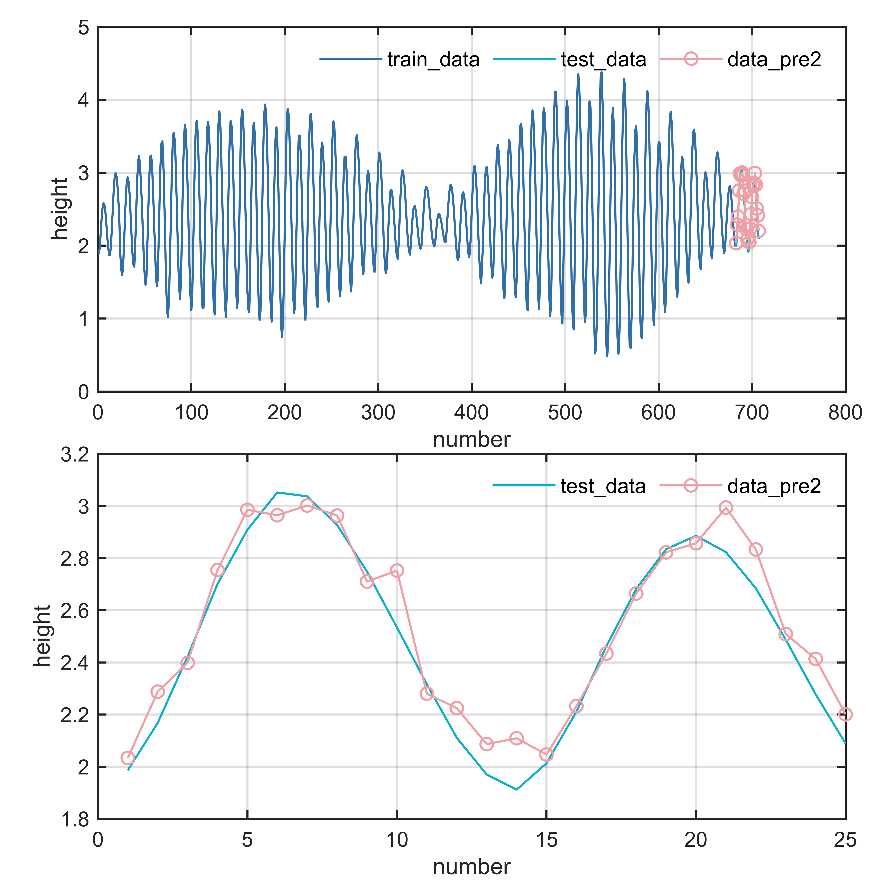

# MATLAB | Time Series Forecasting | ELM - Extreme Learning Machine | Attached data and code for plotting | Directly Implementable

ELM (Extreme Learning Machine) is a single-layer feedforward neural network structure. Unlike traditional neural networks, ELM's hidden layer neuron weights and biases are randomly initialized, and they do not need to be updated during the training process. This random initialization method significantly speeds up the training of ELM, avoiding the need for repeated adjustments in traditional neural networks. The training process of ELM can be summarized as follows:
1. Randomly initialize the weights and biases of the hidden layer neurons to construct the network structure.
2. Input the training data into the network to obtain the output of the hidden layer neurons.
3. Perform linear regression on the output of the hidden layer neurons and the labels of the training data to obtain the weights of the output layer.
4. In the testing phase, input the input data into the network to calculate the output results through the hidden layer neurons and the output layer weights.
The advantage of ELM lies in its very fast training speed and good generalization capability, making it suitable for large-scale data. However, its disadvantages include random initialization potentially leading to unstable results and overly simplified network structures that may not be able to handle complex nonlinear problems. Therefore, in practical applications, it is necessary to balance these considerations based on specific issues.
The following is an illustration of the network structure:
\n        \n  
The following is a video tutorial on how to use ELM:
\n        \n          \n          \n          \n          \n            To view this video please enable JavaScript, and consider upgrading to a\n            web browser that\n            supports HTML5 video\n

## Images

<!-- PAYMENT_BLOCK -->

## Get this dataset

- Payment link (Stripe): [Buy now](https://buy.stripe.com/3cs8yP7sY87d0vu9AB)
- Payment QR code: 

<!-- /PAYMENT_BLOCK -->
